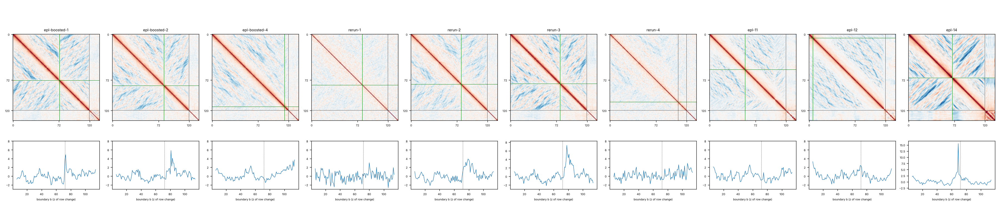

This summary covers everything I did after you uploaded the model folder. It also includes the two items from the outstanding-questions list you asked for: the finer chain-pattern test (§3) and the coverage proof (§4). The main report (version 12, §3.17–3.18 and §4) has the full tables. This summary gives the results in order of interest, with enough detail to judge them, and points to the main report for the rest. The two new pieces (§3 and §4 here) are not in the main report yet.

**Notation.** A word is read right to left. Output slot $k$ is where a pointer that starts at point $k$ ends up. A *hop letter* is a letter that moves the pointer. $L$ is the number of hops and $s$ the number of distinct points the pointer visits (its start included). "Fresh" slots come from newly generated words that no model trained on. All accuracies are teacher-forced at the slot in question.

## 1. The five results worth knowing

1. **`torn-bigger-13` has memorised its long training chains.** It is right on 100% of its own training slots with 12 to 17 hops, but on fresh slots with the same hop counts its accuracy falls from 0.99 at 13 hops to 0.72 at 17. Its general rule is reliable to about 13 hops, and the decline starts *inside* the range its training file covers. (§2)
2. **What makes a long chain hard is going back and forth, not having few points.** The fresh-data control looked weak on chains through few points. With the number of points held fixed, the new test shows the real cause: chains that keep returning to the point they just left. A 5-point chain that cycles $a\,b\,c\,d\,e\,a\,b\ldots$ is as easy as any. A 5-point chain that ping-pongs $a\,b\,a\,b\ldots$ costs `torn-bigger-13` 28 to 29 points of accuracy and the control 14 to 30. (§3)
3. **The paper's $S_{10}\to S_{25}$ result needs no extrapolation, and this is now a proof rather than an estimate.** Every chain pattern in the test distribution with at most 10 points occurs in the training distribution at a rate I can write in closed form. The ratio to the test rate is never below 0.055 for the patterns in the real test file. Patterns with 11 or more points have probability $1.2\times10^{-6}$ per test slot, and the real test file has none. (§4)
4. **The block structure of Figure 5b is a run-to-run accident.** About half of the runs with the same config have a boundary, each at a different place (69 to 81). The first layers' heads avoid attending across it, but chains across it are no harder. My best explanation is a symmetry broken by the early layers' local attention, not a feature of the algebra or the data. (§5)
5. **The repo's `torn-bigger-13` is the February 2025 model.** The Spartan copy was resumed nine months later and is a little better on long chains but has the same shape of limit. `torn-bigger-13` is also the only general-transposition run that learned the task: one other run, `torn-bigger-9`, looks perfect only because its attention mask lets it see the answers. (§6)

## 2. `torn-bigger-13` memorises its long chains

**The clue** came from the wandb export. From about epoch 80 to 100 the training loss of `torn-bigger-13` falls to about $4\times10^{-9}$ while its validation loss stays near $10^{-5}$. That is a gap of 2,000 to 3,800 times, and it persists to the end.

**The test** (Test 16, `run_memorisation.py`) gives every output slot of all 8 million training words its hop count. It then compares accuracy on training slots with accuracy on fresh slots that have the same hop count:

| hops $h$ | training slots available | its own training slots | fresh slots | `g_m10` (fresh-data control), fresh | `g_plant10`, fresh |
|---|---|---|---|---|---|
| 12 | 1500 | 1.000 (18.8) | 0.999 (18.8) | 0.993 | 1.000 |
| 13 | 1500 | 1.000 (17.7) | 0.989 (17.4) | 0.990 | 1.000 |
| 14 | 1468 | 1.000 (16.7) | 0.976 (15.5) | 0.989 | 1.000 |
| 15 | 270 | 1.000 (15.5) | 0.943 (13.0) | 0.985 | 1.000 |
| 16 | 34 | 1.000 (13.8) | 0.868 (9.5) | 0.978 | 1.000 |
| 17 | 2 | 1.000 (12.4) | 0.719 (7.6) | 1.000 (32 slots) | 1.000 |

Accuracy, with the median logit margin in brackets. Fresh slots number 1,500 per hop count up to 15, then 228 at 16 hops and 32 at 17.

**Why it is interesting.**
- **Fresh slots.** The training-versus-fresh difference is significant at every hop count from 13 to 16 (Fisher's exact test, $p = 3\times10^{-5}$ to $0.02$). Up to 12 hops the margins agree exactly (18.8 and 18.8); from 13 hops they part.
- **The cliff.** The file holds 1,468 training slots with 14 hops, yet 2.4% of fresh 14-hop slots are wrong. The cliff is therefore not "beyond the data", which versions 4 to 7 of the report said it was.
- **A natural reading:**
  - a learned rule that composes chains to about 13 hops (the reach the probes find after layer 5), plus memorised long chains on top;
  - once the training file is fitted to $10^{-9}$, no gradient is left to lengthen the rule.

  This is a hypothesis; the final checkpoint cannot say whether the rule was ever longer.
- **The elementary models do not do this.** Five of them were tested, and four end with a validation loss 40 to 3,000 times their training loss. Yet their training, validation and fresh slots are equally accurate at every hop count, up to 70–79 hops. So a static training file plus a large loss gap does not by itself mean memorisation.

## 3. Beyond hops and points: the order of revisits (new)

Until now I had described each chain only by its hop count $L$ and its number of points $s$. Section 4.2 of the report listed "the order of revisits, and the gaps between hop letters" as the obvious next refinement. This test does that (`pattern_families.py`, 200 planted words per cell).

**Walk shape at fixed $(L, s)$.** The hop letters are spread at random over the word, and the other letters avoid the pointer. Four families of walk, ordered by the share of hops that return to the point just left (a *reversal*):
- **cycle** $a\,b\,c\,d\,e\,a\,b\ldots$, which never reverses;
- **random walks** from the lowest third of reversal shares;
- **random walks** from the highest third;
- **ping-pong** $a\,b\,a\,b\ldots$, with the remaining points visited once each along the way.

| | `torn-bigger-13` | `g_m10` | `g_plant10` |
|------------------------------------------|-----------|-----------|----------|
| $L=16$, $s=5$: cycle → ping-pong | 0.96 → 0.68 | 0.99 → 0.86 | 1.00 → 1.00 |
| $L=18$, $s=5$: cycle → ping-pong | 0.75 → 0.46 | 1.00 → 0.70 | 1.00 → 1.00 |
| $L=16$, $s=10$: range over the four families | 0.87–0.90 | 0.99–1.00 | 1.00 |
| $L=20$, $s=10$: cycle → ping-pong | 0.47 → 0.54 | 1.00 → 0.90 | 1.00 → 1.00 |

**What it shows.**
- **Reversals are what hurt.** At 5 points both models are near perfect on cycles and fall steadily as the reversal share rises; cycle against ping-pong gives $p<10^{-8}$ for both models at both lengths.
- **This explains the control's "few points" weakness.** Its weakness on chains through 3 to 5 points (report §3.17) is a weakness on back-and-forth chains. Few-point chains are simply the ones that must reverse often. With 10 points the walks cannot reverse much (at most about 30% of hops), and the effect is small: none for `torn-bigger-13`, which at that length is limited by hop count anyway, and 10 points for the control at 20 hops.
- **`torn-bigger-13` has both limits.** On cycles it still declines with hop count (0.96 at 16 hops, 0.75 at 18, 0.47 at 20), so its hop limit remains. Reversals add a second cost on top.
- **`g_plant10` has neither.** It is perfect in every cell, with margins of 13 to 15 throughout.

**A possible mechanism** (an interpretation, not tested). In report §4.1 the first blocks link each hop letter to the next one *by content*, attending to letters that share a point. In a cycle, each hop letter shares a point only with its two neighbours on the chain, so content picks out the next link. In a ping-pong stretch every hop letter is the same pair $\{a,b\}$, so content matches every other hop letter equally. The link then has to be made by position order alone, which content-based attention does badly. This predicts that the cost should grow with the length of the longest back-and-forth stretch rather than with the reversal share as such, which can be tested.

**Placement of the hop letters** ($L=16$, $s=10$, random walk):

| hop letters | `torn-bigger-13` | `g_m10` | `g_plant10` |
|---|---|---|---|
| spread at random | 0.895 (9.3) | 0.98 | 1.00 |
| one block, read first (end of the word) | 0.86 (5.2) | 0.97 | 1.00 |
| one block in the middle | 0.815 (5.7) | 1.00 | 1.00 |
| one block, read last (start of the word) | 0.77 (4.6) | 1.00 | 1.00 |

- **Packing the hops together costs `torn-bigger-13` a little.** Spread against "read last" gives $p=0.001$, and its margins halve. Natural words almost never have 16 consecutive hop letters, so this may just be unfamiliarity.
- **The other two models are not affected.**
- **One uninformative cell.** The "every other letter" placement (12 hops) was perfect for all models, but 12 hops is within everyone's reach.

**Natural slots.** Within each hop count (14, 15, 16) I split `torn-bigger-13`'s fresh slots by reversal share and by where the hop letters sit. Neither split shows a significant difference: the largest is at 16 hops, 0.92 against 0.98 with about 80 slots per half, $p=0.28$, and it goes the other way from the planted result. This is expected: natural slots with 14 to 16 hops visit 8 to 11 points, where planted walks also showed no reversal effect.

**For the density notion** (§7): the coverage half needs only $(L, s)$, as §4 shows. The closure half (what the model actually gets right) needs the walk shape too, at least the reversal structure.

## 4. Coverage, written out (new)

This is the counting argument behind report §4.2, Step 2, made exact (`coverage.py`).

**Setup.**
- *Test words*: 25 letters, each uniform over the 625 tokens $(a,b)\in[25]^2$.
- *Training words*: choose a uniformly random set $M$ of 10 of the 25 points, then 25 letters each uniform over the 100 tokens on $M$. This is the paper's construction (natural 10-point words, relabelled into 25 points).

Fix one labelled chain for slot $k$: the positions of its $L$ hop letters, and its walk, which visits a set $V$ of $s$ points.

**One labelled chain.** The slot has exactly this chain when:
- each hop letter is one of the two tokens $\{(x,y),(y,x)\}$ for its step $x\to y$;
- every other letter avoids the pointer's current point $p$, meaning it has neither coordinate equal to $p$.

The admissible tokens for a non-hop letter are those without $p$ as a coordinate, plus the diagonal token $(p,p)$, which moves nothing. That is $24^2+1 = 577$ of the 625 tokens in a test word, and $9^2+1 = 82$ of the 100 in a training word. So
$$
P_{\text{test}} = \Big(\tfrac{2}{625}\Big)^{L}\Big(\tfrac{577}{625}\Big)^{25-L},
\qquad
P_{\text{train}} = \Pr(V\subseteq M)\,\Big(\tfrac{2}{100}\Big)^{L}\Big(\tfrac{82}{100}\Big)^{25-L},
\qquad
\Pr(V\subseteq M)=\frac{\binom{25-s}{10-s}}{\binom{25}{10}} .
$$

**The ratio depends only on $(L,s)$:**
$$
R(L,s)=\frac{P_{\text{train}}}{P_{\text{test}}}=\frac{\binom{25-s}{10-s}}{\binom{25}{10}}\Big(\tfrac{625}{100}\Big)^{L}\Big(\tfrac{0.82\cdot625}{577}\Big)^{25-L}\quad(s\le10),\qquad R(L,s)=0\quad(s\ge11).
$$

**From one chain to a class.** Both distributions are invariant under relabelling the 25 points, and under moving the hop letters to other positions. So every labelled chain in a class $(L,s)$ has the same ratio, and the ratio of the class probabilities is also $R(L,s)$. That is the whole proof.

**Checks.** Simulating one million words from each distribution reproduces $R$ in every class with enough samples:

| $(L,s)$ | $(1,2)$ | $(3,3)$ | $(4,4)$ | $(5,5)$ | $(6,6)$ | $(7,7)$ | $(8,8)$ | $(8,9)$ |
|---|---|---|---|---|---|---|---|---|
| simulated | 0.055 | 0.940 | 2.105 | 4.230 | 7.449 | 10.887 | 12.959 | 1.502 |
| formula | 0.055 | 0.939 | 2.101 | 4.225 | 7.432 | 11.010 | 12.912 | 1.519 |

**What it gives.**
- **Uncovered mass.** The test distribution puts $1.2\times10^{-6}$ of its slots on chains with 11 or more points (30 of 25 million in simulation). Those are the only test patterns training words cannot contain.
- **The real test file** (2,000 words) has at most 9 hops and 9 points per slot. Over its moved slots, $R$ is at least 0.055, with a median of 0.13.
- **The rarest class.** In the 8 million training words the rarest class in the test file, $(L,s)=(8,9)$, is expected about 27,000 times.
- **Short chains are relatively rarer in training.** $R<1$ for short chains through many points: the test distribution's typical one-hop slot is 18 times rarer in training. But in absolute numbers those classes are enormous in both.

So the coverage half of the density notion is a theorem with explicit constants. Every test pattern lies in the training support, at a rate at least $1/18$ of its test rate ($\min R = R(1,2) = 0.055$), except a $10^{-6}$ tail.

## 5. The block structure

**The survey** (`block_survey.py`) scores each position $k$ by how much rows $k$ and $k+1$ of the position-cosine matrix differ, as a robust $z$-score. Figure 5b's model scores $z\approx5$ at 72; untrained models score at most 2.5.

| run | seed | boundary |
|--------------------------------------------|----------|---------------------------|
| `elem-partitioned-long-boosted-1` (Figure 5b) | 42 | 72 ($z$ 4.9) |
| `boosted-2` | 43 | 81 ($z$ 5.8) |
| `boosted-4` | 97 | none |
| `rerun-2` / `rerun-3` / `rerun-4` (December 2025) | 42 / 43 / 44 | weak at 79 / 78 ($z$ 7.3) / none |
| `elem-partitioned-long-14` (older architecture) | 42 | 69 ($z$ 15.6) |
| `-11`, `-12` (older architecture) | 42 | none |

**What it shows.**
- **Common but not fixed.** Three of the six fully trained runs with Figure 5b's config have a clear boundary, one a weak one and two none. Where there is one, it falls 58 to 68% of the way along the word.
- **Nothing else predicts it.** Its presence is independent of training length (63 to 341 epochs) and of accuracy, and the same seed gave different results in February and December.
- **The first layers use it.** Several block-1 heads put 0.04 to 0.56 of their usual weight on nearby letters across the boundary (`block_attention.py`).
- **It costs nothing.** Chains whose hops straddle it are followed as well as chains inside one block (`block_crossing_test.py`).
- **Two explanations ruled out:**
  - the query reading the letters just after it (`block_query_read.py`);
  - a single "which half" direction in the embeddings (`block_pc_step.py`).

**Hypothesis** (report §4.3). The early heads must keep their attention local over a 120-letter word. Making the positions of one stretch alike and unlike those of another is a cheap way to do that. Where the split falls hardly matters to the loss, so each run picks a place by chance, and some never split at all. This is spontaneous symmetry breaking. On this reading the block structure says nothing about the algebra, and nothing for or against density.

## 6. Provenance and housekeeping

- **Which `torn-bigger-13`.**
  - The repo checkpoint is bfloat16, like every February 2025 save. The Spartan copy is float32, saved on 29 November 2025 after an automatic resume of 24 more epochs with a fresh optimiser.
  - So the report is about the February model (161 epochs), presumably the paper's.
  - The resumed model is 2 to 18 points better at 15 to 22 hops, with the same shape of limit, and still gets 99.3–100% of its training slots.
- **Older checkpoints.** Every model before 11 February 2025 has an extra attention layer before the blocks, with no layer norm and no residual. Some also store non-standard attention masks. `np_transformer.py` now reads both; before this fix those models scored at chance.
- **`torn-bigger-9`'s mask lets the word positions see the teacher-forced answers.** Its 100% at 24 hops is an artefact.
- **The other general runs** (`torn-bigger-5` to `-8` and `-10` to `-12`) never left the plateau. So `torn-bigger-13` is the only general model with the original recipe that learned the task.

## 7. What it adds up to

**The algorithm** (report §4.1, an interpretation):
1. At the word positions, the early blocks link each hop letter to its chain neighbours by shared points.
2. The layers build each letter's *continuation* (where a pointer leaving it ends up), with a reach that grows faster than one hop per layer: about 1, 1, 4, 8 and 13 hops after layers 1 to 5.
3. The query finds the chain's first hops and reads the continuation off.
4. The rule fails beyond its reach (a hop limit); long training chains are memorised separately.

The new reversal result fits step 1: content-based linking cannot tell apart the identical letters of a back-and-forth stretch.

**Density.** The notion I would propose has two halves:
- **Coverage.** The chain patterns, up to relabelling, that the training data contain often enough. For the paper's setting this is now proved (§4) and is all the $S_{10}\to S_{25}$ result needs.
- **Closure.** What the training procedure makes of that coverage, which I can only measure:
  - `torn-bigger-13` gets *less* than its data cover (it stops at about 13 hops; its file goes to 18);
  - the fresh-data control and the elementary models get *more* (to 22 and 118 hops);
  - `g_plant10` gets everything I tested.

  §3 shows that closure is not a function of $(L,s)$ alone: back-and-forth walks fall outside it sooner.

## 8. Outstanding questions

1. **Was the rule of `torn-bigger-13` ever longer?** Snapshots during a faithful rerun (prepared in `hpc-replication/`) would show whether the hop limit was there from the start or was overtaken by memorisation.
2. **Frequency or recipe?** A single-change rerun with a larger static file would say how much of the original's edge comes from the amount of data rather than the training recipe.
3. **Run length or reversal share?** Does the reversal cost track the longest back-and-forth stretch, as the content-linking mechanism predicts? This is a cheap planted test.
4. **What does `g_plant10` do?** It shows no probe staircase, no hop limit and no reversal cost, and I have not found its algorithm.
5. **When does the block boundary form, and does removing it cost anything?** This needs snapshots of a run that forms one; projecting the boundary out after training could be done now.

## 9. Files

The scripts and results added in this period are all in `claude-analysis/`:
- `run_memorisation.py`, `elem_memorisation.py`, `hop_points_grid.py`, `cliff_survey.py`;
- `pattern_families.py` and `.json`, `make_pattern_figure.py`;
- `coverage.py`, `coverage_results.json`;
- `block_survey.py`, `block_attention.py`, `block_crossing_test.py`, `block_query_read.py`, `block_pc_step.py`.

The folder survey is in `snapshot-survey/`.
